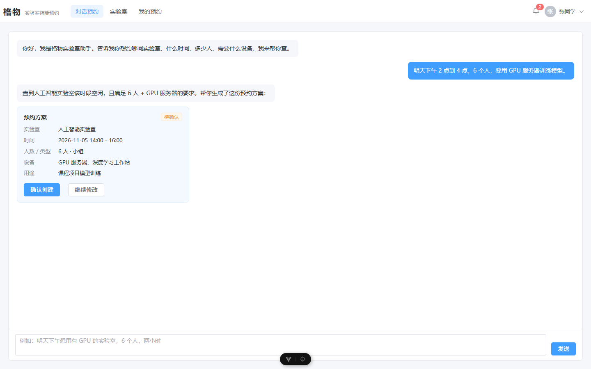
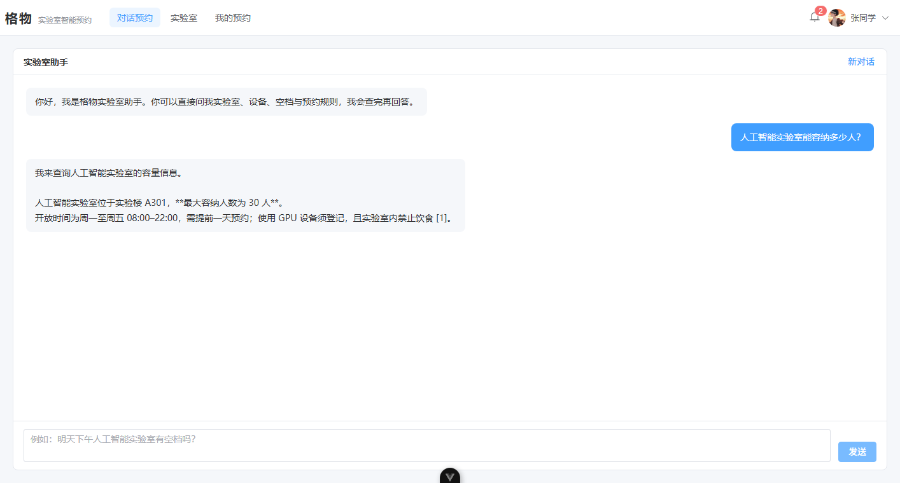
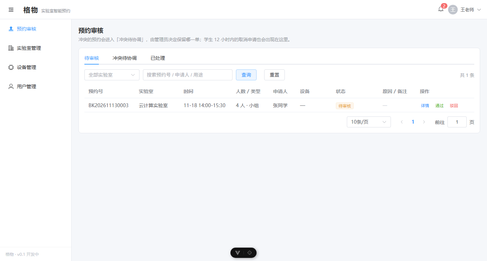
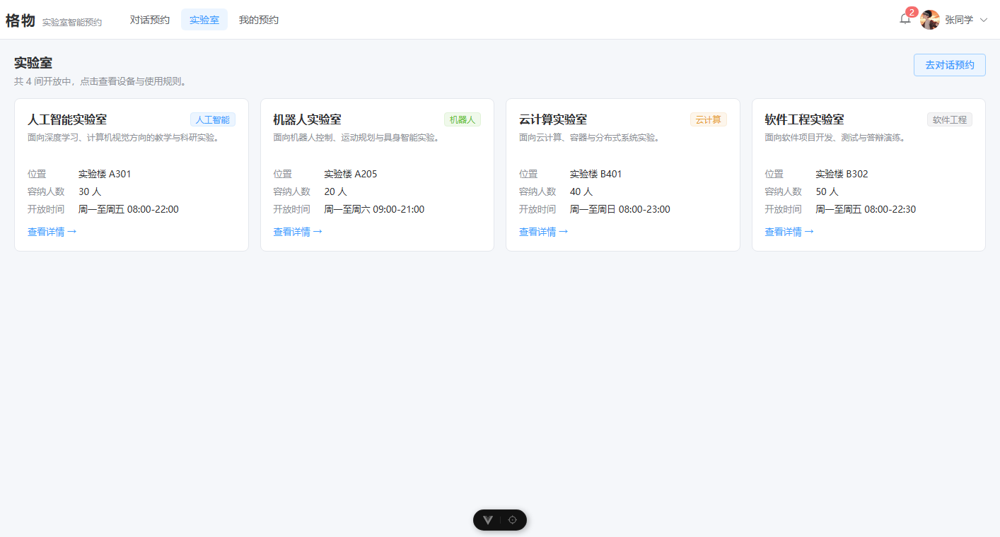
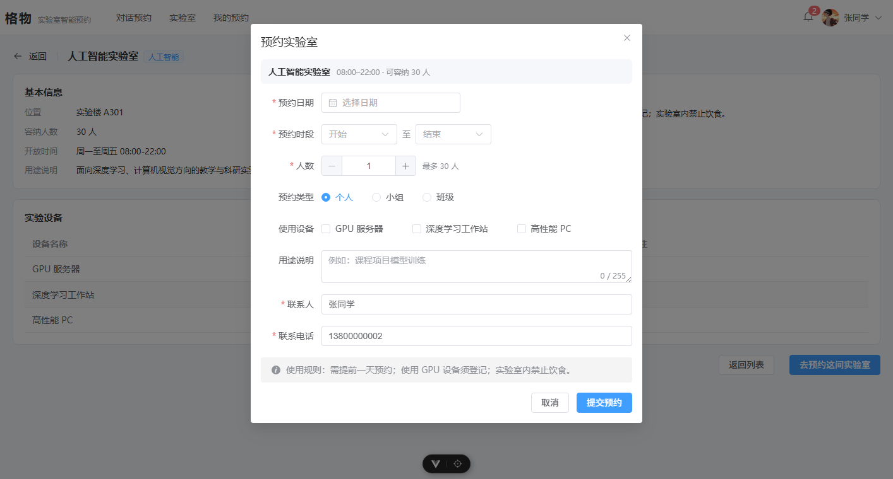

# 格物 · Gewu Lab

实验室智能预约平台：学生用一句中文描述需求，AI 帮你查实验室、查空闲时段、查设备，把可预约的方案整理成一张**可点击确认的预约单**；管理员在后台管实验室、设备、预约审核与用户。

后端 FastAPI + MySQL + Redis Stack，对话编排用 LangGraph 走 SSE 流式返回，知识库用 Redis 向量检索做 RAG 问答。



## 它解决什么问题

高校实验室预约通常是这样：翻网页找实验室 → 看开放时间 → 翻设备清单 → 填一堆表单 → 撞上时间冲突再重来。格物把这套流程压成一句话：

> 「帮我把明天下午两点到四点的人工智能实验室订了，5 个人，需要带 GPU 的机器」

AI 走完后端真实校验（开放日、时长、人数上限、设备归属、时间重叠），确认可行就生成预约单卡片；用户点「确认预约」才真正入库，不确认则什么也不发生。

## 功能

| 角色 | 能做什么 |
|---|---|
| 学生 | 对话式预约（SSE 流式）、实验室浏览与详情、我的预约（取消 / 申请取消）、个人资料 |
| 管理员 | 预约审核（通过 / 驳回 / 冲突协调）、实验室管理、设备管理、用户管理、文件上传 |
| AI | 8 个工具：实验室查询、设备查询、空闲时段计算、我的预约、预约可行性校验、预约单生成、知识库检索 |
| 知识库 | Markdown 语料切块 → embedding → Redis Stack HNSW 向量检索，回答预约规则、安全须知这类问题 |

## 技术栈

| 层 | 选型 |
|---|---|
| 后端 | Python 3.12、FastAPI 0.115、SQLAlchemy 2（async + aiomysql）、Pydantic v2 |
| 数据库 | MySQL 8 |
| 缓存 / 向量库 | Redis Stack（LangGraph checkpoint + HNSW 向量索引） |
| AI | LangGraph 1.2 + langchain-openai，模型走百炼 `qwen-plus`（OpenAI 兼容接口），embedding 用 `text-embedding-v3`（1024 维） |
| 前端 | Vue 3 + Element Plus + Vue Router + Vite + axios |
| 鉴权 | JWT（bcrypt 存密码），前端路由按角色分流 |
| 测试 | pytest（62 passed / 3 skipped）、`node scripts/check-sse.mjs`（SSE 解析器用例） |

## 架构

```
浏览器 (Vue 3)
   │  axios / fetch(SSE)
   ▼
FastAPI 路由层  app/api/routes
   │  鉴权 + 参数校验 + 统一 {code, message, data} 信封
   ▼
服务层  app/services
   ├── booking_service   预约规则与冲突判定
   ├── knowledge_service 语义检索
   └── ai_service        对话调度：跑图、转事件、兜底
          │
          ▼
     LangGraph 图  app/ai/graph.py
        START → agent ──有 tool_calls?──▶ tools ──┐
                  │  ▲                            │
                  │  └────────────────────────────┘
                  └─ 没有 → END
          │                         │
          ▼                         ▼
   MySQL(业务数据)          Redis Stack(checkpoint 存档 + 向量索引)
```

对话一轮的事件流（一条 SSE 长连接）：

```
user_message → token… → tool_call → tool → … → booking_card → token… → done
```

AI 只「出卡片」，不直接写库：真正的创建走用户点击后的 `POST /api/bookings`，复用服务层同一套校验。这样 AI 不越权，规则也只有一份。

## 目录结构

```
格物 · Gewu Lab/
├── backend/            FastAPI 服务
│   ├── app/            api / services / models / schemas / core / ai / knowledge
│   ├── tests/          pytest 用例
│   └── scripts/        建表、造数据、建知识库、冒烟脚本
├── frontend/           Vue 3 前端
│   └── src/            api / components / views / router / utils
├── docs/
│   ├── knowledge/      RAG 语料（9 篇 Markdown）
│   └── screenshots/    界面截图
└── LICENSE
```

AI 链路的代码集中在 `backend/app/ai/`（`graph.py` 图、`agent_tools.py` 工具外壳、`tools.py` 业务实现、`prompts.py` 提示词、`runtime.py` 存档）与 `backend/app/services/ai_service.py`，**每个文件顶部都有面向初学者的导读**，可以按 `backend/app/ai/__init__.py` 里给出的阅读顺序看。

## 快速开始

前置：Python 3.12、Node.js 22.18+ 或 24.12+、MySQL 8、Redis Stack（带 `search` 模块，Docker 起一个即可：`docker run -d -p 6379:6379 redis/redis-stack-server:latest`）。

### 后端

```powershell
cd backend
python -m venv .venv
.venv\Scripts\Activate.ps1
python -m pip install -r requirements.txt
Copy-Item .env.example .env      # 改数据库、Redis、AI_API_KEY

.venv\Scripts\python.exe -m scripts.init_db       # 建表（幂等）
.venv\Scripts\python.exe -m scripts.seed_users    # 种子账号
.venv\Scripts\python.exe -m scripts.seed_labs     # 实验室
.venv\Scripts\python.exe -m scripts.seed_devices  # 设备

uvicorn app.main:app --reload --host 127.0.0.1 --port 8000
```

接口文档：<http://127.0.0.1:8000/docs>；健康检查：`GET /hello`。

种子里有两个账号（**仅本地演示用，上线务必改掉**）：

| 账号 | 密码 | 角色 |
|---|---|---|
| `admin` | `123456` | 管理员（王老师） |
| `student` | `123456` | 学生（张同学） |

### 前端

```powershell
cd frontend
npm install
npm run dev        # 默认 5173，/api 与 /media 已代理到 8000
```

### 知识库（可选，不配也能跑业务）

```powershell
cd backend
.\.venv\Scripts\python.exe -m scripts.build_kb --dry-run   # 只看切块，不联网
.\.venv\Scripts\python.exe -m scripts.build_kb             # 建索引（需要 AI_API_KEY）
.\.venv\Scripts\python.exe -m scripts.kb_smoke             # 冒烟
```

没有 `AI_API_KEY` 时，`/api/ai/*` 与 `/api/knowledge/*` 会直接返回 503，其余功能不受影响。

完整的配置项说明见 [backend/README.md](backend/README.md)。

## 测试

```powershell
cd backend
.\.venv\Scripts\python.exe -m pytest                          # 62 passed / 3 skipped
cd ..\frontend
node scripts/check-sse.mjs                                    # SSE 解析器 7 组用例
npm run build                                                 # 构建校验
```

跳过的 3 个用例需要真实 Redis Stack：设置 `GEWU_TEST_REDIS_URL` 后即可运行。

## 截图

| 对话与预约 | 预约审核 |
|---|---|
|  |  |

| 实验室列表 | 预约表单 |
|---|---|
|  |  |

更多截图在 `docs/screenshots/`。

## 已知限制

- 登录没有限流与验证码；JWT 只做了签名校验，没做主动失效名单。
- 取消预约需在开始前 12 小时，规则写在服务层；不同学校口径不同，需要按需改。
- 知识库是纯向量检索（中文全文分词不可用），表格类语料切块偏粗。
- 对话上下文按 `thread_id` 存 Redis，不会自动过期（`AI_THREAD_TTL_SECONDS` 目前未生效），清理需手工删 `gewu:ai:*`。
- `recursion_limit=12`：一轮对话最多约 5 轮「查数据 → 再思考」，超了会中断并提示重试。

## License

[MIT](LICENSE)
